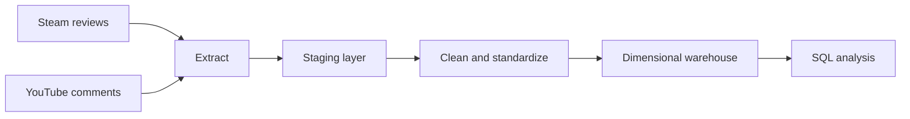
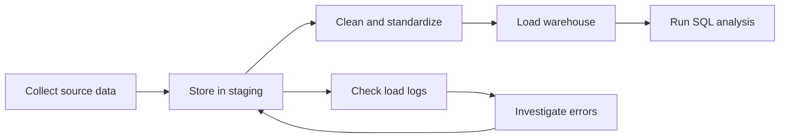
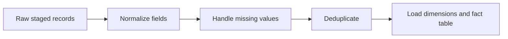

<!-- @slide Title -->

<!-- 5xl -->
# Player Feedback Data Warehouse

*A unified data warehouse for analyzing online game reviews and comments.*

Author: Nyamryenchin Tuvshin  
Neptun: A0PYWU  
Supervisor: Anett LENART  
Project ID: 2026-LA-03

---

<!-- @slide Problem -->

## Problem

<!-- @set-align left -->
<!-- @set-width 70% -->

- Player feedback is spread across **different online platforms**, including Steam and YouTube.
- Reviews and comments have **different structures, fields, timestamps, and language information**.
- Comparing feedback across games and time periods is difficult without a consistent data model.

<!-- @callout question -->
> How can feedback from different platforms be collected and integrated into one reliable warehouse for analysis?

<!-- @note -->
> The project analyzes what people write about games. It does not focus on in-game performance, player skill, or match behavior.

---

<!-- @slide Project idea -->

### From online feedback to useful analysis

The pipeline preserves source data, prepares consistent records, and loads them into a structure designed for analytical queries.

<!-- @note -->
> The staging layer keeps source and load information traceable. The warehouse provides a unified structure for comparing feedback.

---

<!-- @slide Target users -->

## Target users

<!-- @set-align left -->
<!-- @set-width 70% -->

**The system is intended for technical users who need to collect, manage, and analyze feedback data.**

- **Data engineer:** runs extraction and loading scripts, checks load logs, and investigates data-quality issues.
- **Analyst or researcher:** runs SQL queries to compare feedback by game, source, date, and language.

The planned workflow uses scripts and SQL. A graphical user interface or BI dashboard is not required for the first version.

---

<!-- @slide Planned scope -->

## Planned scope

<!-- @set-align left -->
<!-- @columns 2 4 -->

### In scope

- Steam reviews and YouTube comments
- Counter-Strike 2, Cyberpunk 2077, and Grand Theft Auto V
- Separate staging layer and load logging
- Data cleaning and standardization
- Duplicate handling and incremental loading
- Fact table and dimension tables
- At least 10 analytical SQL queries
- Measure and optimize at least 5 queries
- Process several hundred thousand records

<!-- @col-break -->

### Out of scope

- A complex web application or BI dashboard
- Additional platforms in the initial version
- Mandatory AI-based sentiment analysis
- Analysis of player skill or match performance
- A full social-media analytics product

<!-- @columns -->

<!-- @note -->
> Sentiment analysis may be considered as a future extension. Steam recommendation data can provide a positive/negative signal, but YouTube comments do not provide the same built-in label.

---

<!-- @slide Workflow rules -->

### How the data pipeline should behave

<!-- @set-align left -->
<!-- @set-width 70% -->

- Raw records are stored in staging before transformation.
- Each staged record should retain its source and load information.
- Source-specific fields and timestamps are standardized before warehouse loading.
- Missing values and duplicate records are handled using documented rules.
- Re-running a load should not create duplicate warehouse records.
- Incremental loading should process new or changed records rather than reload everything unnecessarily.

<!-- @note -->
> The exact incremental-loading strategy and source limitations must be documented and verified during implementation.

---

<!-- @slide User journeys -->

## Initial user journeys

The main journeys cover data collection, processing, analysis, and troubleshooting.

---

<!-- @slide Journey 1 -->

### Collect and load feedback

<!-- @set-align left -->
<!-- @set-width 70% -->

1. Run the extraction process for Steam reviews or YouTube comments.
2. Store the original records in the staging layer.
3. Record source and load metadata for traceability.
4. Validate the extracted data and inspect load logs.
5. Identify failed or incomplete loads before continuing.

<!-- @note -->
> The current Steam extraction code has been written but still needs verification with real data. YouTube extraction and broader game coverage remain planned work.

---

<!-- @slide Journey 2 -->

### Transform data and load the warehouse

<!-- @set-align left -->
<!-- @set-width 70% -->

- Standardize fields and timestamps across sources.
- Apply documented rules for missing values and duplicate records.
- Load the dimensional model so records can be analyzed consistently by game, source, date, and language.
- Support incremental loading.

<!-- @note -->
> The final dimensional model and loading rules are still to be designed and implemented. The proposed database is Microsoft SQL Server, pending supervisor confirmation.

---

<!-- @slide Journey 3 -->

### Analyze and compare feedback

<!-- @set-align left -->
<!-- @set-width 70% -->

1. Run SQL queries against the warehouse.
2. Compare feedback volume by month and game.
3. Compare sources and language distributions.
4. Analyze available evaluation characteristics.
5. Measure query performance and optimize at least five queries.

<!-- @callout info -->
> Example question: “How does the monthly volume of feedback differ between Steam and YouTube for each selected game?”

<!-- @note -->
> The project requires at least ten complex analytical queries. Results and performance measurements should be documented rather than merely claiming that a query is optimized.

---

<!-- @slide Next steps -->

## Next steps

<!-- @set-align left -->
<!-- @set-width 70% -->

- Verify the existing Steam extraction and staging code using real data.
- Confirm database technology and finalize the dimensional model.
- Implement YouTube extraction and cover all three selected games.
- Define cleaning, deduplication, and incremental-loading rules.
- Build and load the fact and dimension tables.
- Complete at least 10 analytical queries and optimize at least 5.
- Test data quality and document setup, limitations, and results.

<!-- @note -->
> The first milestone is a small, verified end-to-end pipeline. After it works reliably, the pipeline can be extended to more records and all selected sources and games.

---
