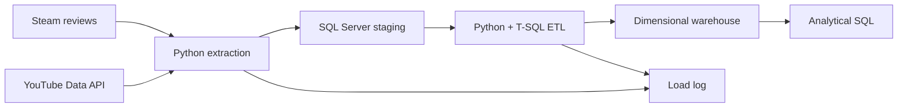
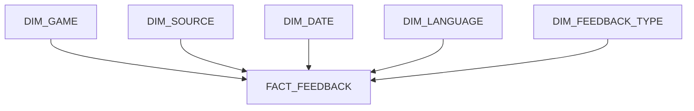
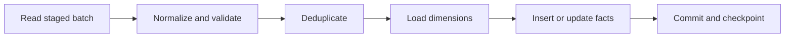

<!-- @slide Title -->

<!-- 5xl -->
# Player Feedback Data Warehouse

*Initial technical proposal and semester-2 implementation plan*

Author: Nyamryenchin Tuvshin  
Neptun: A0PYWU  
Supervisor: Anett LENART  
Project ID: 2026-LA-03

---

<!-- @slide Specification summary -->

## Specification summary

- Integrate Steam reviews and YouTube comments for CS2, Cyberpunk 2077 and GTA V.
- Preserve source data and load metadata in a staging layer.
- Clean and integrate data into a dimensional warehouse.
- Support incremental loading and several hundred thousand records.
- Implement at least 10 analytical SQL queries and measure optimization of at least 5.

<!-- @note -->
> The system is intended for technical users. A complex web interface, BI dashboard and mandatory AI sentiment analysis are outside the initial scope.

---

<!-- @slide User journeys -->

## Main user journeys and requirements

<!-- @columns 2 4 -->

### Data engineer

- Run extraction scripts.
- Inspect staging records and load logs.
- Run transformations and warehouse loading.
- Investigate failures and retry safely.

<!-- @col-break -->

### Analyst / researcher

- Connect to the warehouse using SQL.
- Compare games, sources, dates and languages.
- Analyze available evaluation characteristics.
- Inspect query performance.

<!-- @columns -->

<!-- @note -->
> Key quality requirements are reproducibility, traceability, scalability, secure credential handling and duplicate-free repeated loads.

---

<!-- @slide Technical architecture -->

## Initial technical proposal

### Architecture and proposed technology stack

- Python: API requests, pagination and loading orchestration.
- Microsoft SQL Server: proposed database for staging and warehouse.
- T-SQL: transformations, analytical queries and performance tests.
- Git and `.env`: version control and local credential management.

<!-- @note -->
> SQL Server is pending supervisor confirmation. The stack is a proposal, not a claim that all components are implemented.

---

<!-- @slide Extraction and staging -->

### Source extraction and staging

<!-- @columns 2 4 -->

### Steam

- Review endpoint with cursor pagination.
- Review ID, timestamp, language, recommendation and engagement fields.
- Extractor written; real-data verification pending.

<!-- @col-break -->

### YouTube

- Data API `commentThreads` with page tokens.
- Selected game-related videos and top-level comments.
- Comment ID, timestamp, text and engagement fields.
- Extraction planned.

<!-- @columns -->

Staging: `stg.steam_reviews`, `stg.youtube_comments`, `stg.load_log` (proposed names).

<!-- @note -->
> Preserve original analytical fields and source IDs, load_id and loaded_at. Exclude unnecessary personal identifiers. Video selection and quota handling must be documented.

---

<!-- @slide Dimensional model -->

### Proposed dimensional model

- Grain: one row per unique source review or comment.
- Surrogate keys connect facts to dimensions.
- Unique business key: `(source_key, source_record_id)`.
- Measures: text length and source-specific engagement metrics.
- Steam recommendation and playtime are nullable for YouTube.

<!-- @note -->
> Feedback type is added explicitly to satisfy the original project brief. Unknown language is represented by an Unknown dimension member unless a reliable detection method is agreed. Missing values are not automatically zero or negative.

---

<!-- @slide Model decision -->

### Dimensional modeling alternatives

<!-- @columns 2 4 -->

### Shared fact table

- Common grain and dimensions.
- Simpler cross-source SQL.
- Nullable source-specific fields.

<!-- @col-break -->

### Separate fact tables

- Source-specific measures and constraints.
- Fewer irrelevant nullable fields.
- Cross-source analysis requires aligned aggregation or UNION ALL.

<!-- @columns -->

**Initial preference:** shared fact table, because both sources represent individual feedback records.

<!-- @note -->
> The final choice will follow a comparison of equivalent analytical queries, execution time, logical reads, storage and query complexity on comparable datasets. Engagement measures must retain their source-specific meanings.

---

<!-- @slide ETL -->

### ETL and incremental loading

- Convert timestamps to UTC and standardize data types.
- Apply documented missing-value and duplicate rules.
- Insert new records and update changed records using source IDs.
- Maintain source/game checkpoints after successful processing.
- Roll back failed warehouse batches and record errors.

<!-- @note -->
> Use overlapping retrieval windows or periodic refreshes where supported to capture edits and changing engagement counts. Exact checkpoint and deletion policies depend on API capabilities. Re-running a batch must not create duplicates.

---

<!-- @slide Analysis and testing -->

### Analytical queries and performance validation

- 10 queries: trends, game/source comparison, language distribution, Steam recommendation share, activity peaks, playtime relationship and growth.
- First optimization candidates: monthly trends, game comparison, language distribution, activity peaks and month-over-month growth.
- Compare baseline and optimized execution plans, elapsed time and logical reads.
- Investigate indexes, columnstore and partitioning where justified.
- Test row reconciliation, uniqueness, null rules, foreign keys and repeated loads.

<!-- @note -->
> Use the same dataset and equivalent query results for before/after comparisons. Positive/negative analysis applies to Steam recommendation data unless a separate YouTube classification method is agreed. Raw source volumes do not represent equivalent platform coverage.

---

<!-- @slide Implementation plan -->

## Semester-2 implementation plan

| Phase | Planned deliverable |
|---|---|
| Weeks 1–2 | Confirm database, verify Steam prototype and staging |
| Weeks 3–4 | Compare dimensional models and build warehouse schema |
| Weeks 5–6 | Implement Steam ETL and incremental loading |
| Weeks 7–8 | Implement YouTube extraction and integrate all games |
| Weeks 9–10 | Expand data volume, validate data quality and recovery |
| Weeks 11–12 | Complete 10 analytical queries and optimize 5 |
| Weeks 13–14 | Final testing, reproducibility documentation and presentation |

<!-- @note -->
> Indicative 14-week schedule, subject to the actual semester calendar. API collection may run in parallel with development. The first milestone is a verified end-to-end Steam pipeline.

---

<!-- @slide Risks -->

## Open risks and next steps

| Risk | Mitigation / decision |
|---|---|
| API quotas and unavailable comments | Rate control, resumable extraction and logging |
| Irrelevant or biased YouTube coverage | Document video selection and coverage |
| Missing language or sentiment labels | Unknown language; clarify evaluation scope |
| Changed or duplicate feedback | Stable source IDs, refresh strategy and tests |
| Insufficient volume or slow queries | Monitor volume and benchmark at increasing scale |

### Immediate next steps

Confirm SQL Server and evaluation requirements with the supervisor, verify Steam extraction with real data, and build a small end-to-end warehouse prototype.

<!-- @note -->
> Current status: Git and credential handling are done according to the functional specification. Steam extraction and staging code are written but not verified. Remaining components are planned. Review platform terms, retention and data protection before large-scale collection.
