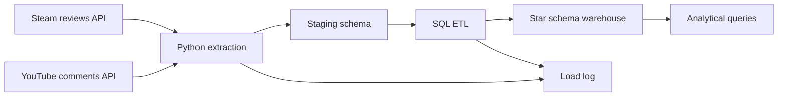
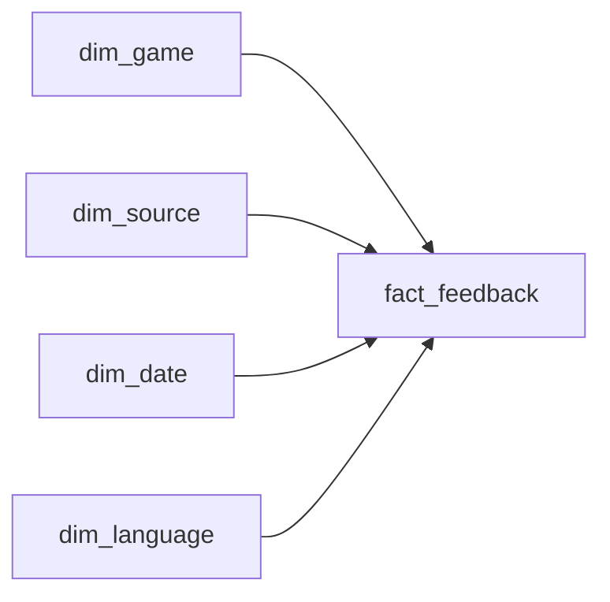

<!-- @slide Title -->

<!-- 5xl -->
# Player Feedback Data Warehouse

*Specification, technical proposal and semester-2 plan*

Author: Nyamryenchin Tuvshin  
Neptun: A0PYWU  
Supervisor: Anett LENART  
Project ID: 2026-LA-03

---

<!-- @slide Specification summary -->

## Specification summary

<!-- @set-align left -->
<!-- @set-width 70% -->

- **Goal:** one warehouse that integrates Steam reviews and YouTube comments for Counter-Strike 2, Cyberpunk 2077 and GTA V.
- **Users:** a data engineer who runs and monitors loads, and an analyst who compares feedback with SQL.
- **Specification:** 24 functional requirements in six groups: collection, staging, ETL, warehouse, analysis, quality and documentation.
- **Out of scope:** web application, extra platforms, mandatory sentiment analysis, dashboard.

<!-- @note -->
> The full list is in 02-specification.md. Each requirement has a status: done, written, or planned.

---

<!-- @slide Journeys and requirements -->

## Main user journeys and requirements

<!-- @set-align left -->
<!-- @columns 2 3 -->

### Journeys

1. **Load:** run the collector, raw data lands in staging, the load is logged
2. **Update:** run the ETL, only new records enter the warehouse
3. **Compare:** query feedback by game, source, month and language
4. **Troubleshoot:** find a failed load in the log and retry it

<!-- @col-break -->

### Key requirements

- Every row traceable to its source and load
- Re-running a load adds no duplicates
- Incremental loading
- At least 10 analytical queries, 5 optimized
- No credentials in the repository

<!-- @columns -->

---

<!-- @slide Technical proposal: architecture -->

## Initial technical proposal: architecture

<!-- @set-align left -->
<!-- @set-width 70% -->

- **Database:** Microsoft SQL Server and SSMS, pending supervisor confirmation
- **Extraction:** Python 3.13 with requests and pyodbc
- **Repository:** Git and GitHub, credentials kept in a git-ignored .env file

---

<!-- @slide Technical proposal: data model -->

## Initial technical proposal: data model

<!-- @set-align left -->
<!-- @set-width 70% -->

- **Grain:** one fact row per review or comment
- **Measures:** text length, likes, replies, recommended flag (Steam only), playtime (Steam only)
- **Traceability:** source record id and load id on every row
- **Design to evaluate:** this shared fact table against one fact table per source, compared on query simplicity and measured speed

<!-- @note -->
> The staging layer already has a draft schema: a load log and a raw Steam reviews table. A YouTube staging table is planned.

---

<!-- @slide Technical proposal: pipeline rules -->

## Initial technical proposal: pipeline rules

<!-- @set-align left -->
<!-- @set-width 70% -->

- **Deduplication:** one row per source and source record id, enforced by a unique key.
- **Incremental loading:** a saved watermark per source and game, so each run fetches only records newer than the last successful load.
- **Failure handling:** a failed load is marked in the load log. The warehouse load runs in one transaction, so it completes or rolls back. Partial staging rows carry their load id.
- **Retry:** safe, because duplicates are removed by key.

<!-- @callout info -->
> The exact checkpoint, where a retry resumes, still has to be defined and tested.

---

<!-- @slide Technical proposal: performance and testing -->

## Initial technical proposal: performance and testing

<!-- @set-align left -->
<!-- @columns 2 3 -->

### Performance

- Baseline each query: time, reads and execution plan
- Change one thing at a time: indexes, columnstore, statistics, query rewrite
- Record before and after in the results folder

<!-- @col-break -->

### Data quality tests

- Row counts match across stages
- No duplicate keys
- No orphan fact rows
- Re-running a load changes nothing

<!-- @columns -->

---

<!-- @slide Semester-2 implementation plan -->

## Semester-2 implementation plan

<!-- @set-align left -->
<!-- @set-width 70% -->

1. **Foundation:** verify the Steam load, confirm the database, create the warehouse tables
2. **First pipeline:** Steam ETL into the warehouse with data quality tests
3. **Full data:** YouTube extraction, all three games, several hundred thousand records
4. **Reliability:** cleaning rules, incremental loading, failure recovery tested
5. **Analysis:** 10 analytical queries
6. **Performance:** measure and optimize 5 queries, compare shared and separate fact tables
7. **Delivery:** documentation, final tests, final presentation

<!-- @note -->
> Phases are planned in this order and will be given weeks once the semester calendar is fixed.

---

<!-- @slide Open risks and next steps -->

## Open risks and next steps

<!-- @set-align left -->
<!-- @columns 3 3 -->

### Open risks

- YouTube comments have no positive/negative label, so positive share covers Steam only
- Comment volume depends on which videos are chosen, so selection rules must be documented
- Reaching several hundred thousand records within API limits
- Shared against separate fact table is not yet decided

<!-- @col-break -->

### Next steps

- Verify the Steam collector with real data
- Confirm SQL Server with the supervisor
- Create the warehouse tables
- Build the Steam ETL

<!-- @columns -->

---
